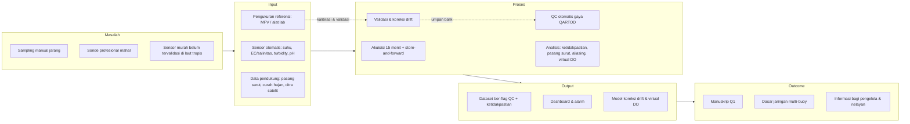
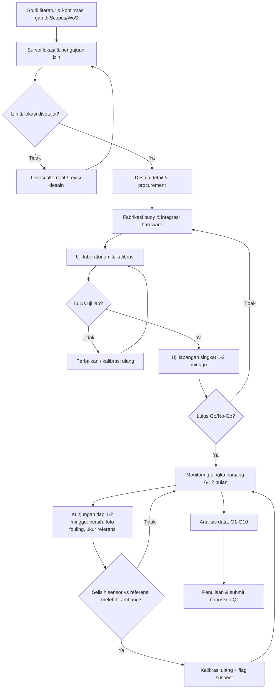
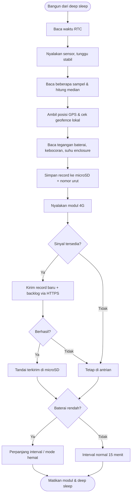
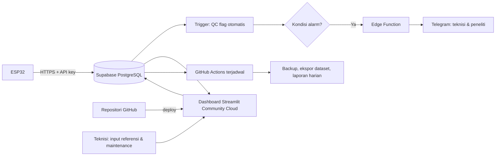
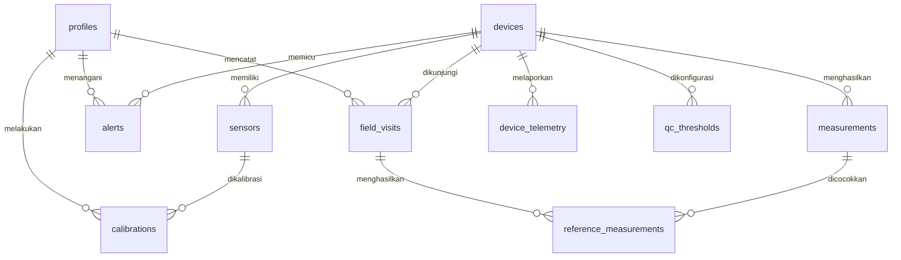

# PRD Smart Marine Monitoring Buoy (SMMB) v1.1

Nov 11, 2026 · @Indri

## 0. Informasi Dokumen

| Item | Keterangan |
| --- | --- |
| Produk | Smart Marine Monitoring Buoy (SMMB) |
| Kategori | Marine Technology · Environmental Monitoring · IoT · Data Science |
| Institusi | Institut Teknologi Sepuluh Nopember (ITS), Surabaya |
| Versi | PRD 1.1 (revisi dari Draft 1.0) |
| Status | Draft for Technical Review |
| Periode pengembangan | 2026–2027, durasi penelitian 6–12 bulan |
| Lokasi kandidat | Pesisir Wonorejo (utama), Tambak Wedi – Kenjeran (alternatif) |
| Anggaran | Maks. Rp10.000.000 (CAPEX prototipe), MPV second maks. Rp3.000.000 |
| Platform software | Kode di GitHub, dashboard di Streamlit Community Cloud |

### Ringkasan perbaikan dari v1.0

- **Strategi pengukuran diperjelas.** v1.0 menargetkan 5 parameter otomatis tiap 10–15 menit, tetapi anggaran hanya memuat satu sensor otomatis tambahan (turbidity) dan MPV portable tidak bisa diasumsikan terhubung ke ESP32. v1.1 memisahkan *sensor otomatis* (data kontinu) dan *MPV/alat lab* (referensi validasi) — lihat Bagian 3.
- **Requirement diberi ID dan prioritas** (FR-xx, NFR-xx, MoSCoW) agar dapat dilacak ke pengujian.
- **Arsitektur disesuaikan ke GitHub + Streamlit Cloud**, termasuk konsekuensinya: Streamlit tidak dipakai sebagai penerima data.
- **Ditambahkan:** power budget, data budget, skema database, contoh payload, aturan QC data, matriks hak akses.
- **Anggaran dipisah CAPEX/OPEX** dan dibuat dua skenario karena beberapa komponen wajib belum masuk anggaran v1.0.
- **Acceptance criteria dibuat kuantitatif** dan risk register diberi skor kemungkinan × dampak.
- **Perizinan & keselamatan navigasi** diperinci; daftar keputusan terbuka ditambahkan di akhir dokumen.

## 1. Project Overview

### 1.1 Deskripsi Produk

SMMB adalah buoy berbasis IoT untuk mengukur kualitas air laut pesisir secara berkala, menyimpan data secara lokal dan di cloud, serta menampilkannya pada dashboard monitoring. Produk dirancang sebagai prototipe teknologi kelautan berbiaya rendah untuk penelitian, pemantauan lingkungan pesisir, pendidikan, dan inovasi maritim.

### 1.2 Problem Statement

- Pengukuran kualitas air pesisir belum dilakukan secara kontinu; alat portable mengharuskan peneliti datang ke lokasi.
- Pengumpulan data manual memakan waktu, tenaga, dan biaya transportasi laut.
- Data lingkungan tersebar dan belum terintegrasi dalam satu dashboard.
- Perubahan kualitas air pesisir (pasang surut, musim, limpasan sungai) membutuhkan data jangka panjang dengan resolusi waktu tinggi.
- Instrumen multiparameter profesional (sonde) relatif mahal untuk penelitian tahap awal.
- Perangkat di laut berisiko rusak, terkorosi, tertutup biofouling, dan dicuri.

### 1.3 Product Vision

Stasiun pemantauan kualitas air laut berbasis buoy yang ekonomis, modular, dan menghasilkan data yang dapat dipertanggungjawabkan secara ilmiah — dengan kualitas data yang terdokumentasi (kalibrasi, validasi, dan flag QC), bukan sekadar angka dari sensor.

### 1.4 Stakeholder

| Stakeholder | Kepentingan | Peran dalam proyek |
| --- | --- | --- |
| Peneliti utama | Dataset valid dan publikasi | Pemilik produk, pengambil keputusan teknis |
| Supervisor / dosen pembimbing | Kualitas ilmiah dan kemajuan | Reviewer, persetujuan milestone |
| Teknisi lapangan | Perangkat mudah dirawat | Instalasi, pembersihan, kalibrasi, log maintenance |
| Mitra masyarakat pesisir / kelompok nelayan | Keamanan dan manfaat informasi | Pengawasan buoy, pelapor kejadian |
| Pengelola kawasan & otoritas terkait | Kepatuhan ruang laut dan keselamatan pelayaran | Pemberi izin / rekomendasi |

### 1.5 Persona Pengguna

- **Researcher** — membuka dashboard untuk melihat tren, membandingkan data dengan pasang surut, dan mengunduh CSV ber-flag QC untuk analisis.
- **Technician** — menerima notifikasi baterai lemah atau data terhenti, mencatat kunjungan, pembersihan, dan hasil pengukuran referensi.
- **Supervisor** — melihat ringkasan ketersediaan data dan status penelitian tanpa perlu detail teknis.
- **Administrator** — mengelola akun, perangkat, ambang alarm, dan konfigurasi.

## 2. Objectives & KPI

### 2.1 Tujuan

1. Membangun satu prototipe buoy berdiameter 80 cm (rentang desain 50–100 cm).
2. Memperoleh lima parameter kualitas air (pH, DO, salinitas, suhu, turbidity) dengan metode yang tervalidasi.
3. Membangun sistem IoT, penyimpanan lokal + cloud, dan dashboard.
4. Mengembangkan GPS tracking, geofence, dan sistem keamanan perangkat.
5. Mengoperasikan buoy di lapangan selama 6–12 bulan.
6. Menghasilkan dataset terdokumentasi dan minimal satu manuskrip ilmiah.

### 2.2 KPI

| KPI | Target | Definisi / cara ukur |
| --- | --- | --- |
| Prototipe | 1 unit | Lulus seluruh acceptance criteria (Bagian 11) |
| Parameter | 5 | Otomatis atau semi-otomatis sesuai strategi Bagian 3 |
| Interval pencatatan otomatis | 15 menit (dapat diatur 10–60 menit) | Interval antar-record terjadwal |
| Data availability | ≥ 90% per bulan | Record valid yang diterima ÷ record yang dijadwalkan |
| Latensi data ke dashboard | ≤ 5 menit | Selisih waktu ukur vs waktu tampil, saat sinyal tersedia |
| Operasi tanpa intervensi | ≥ 14 hari | Di luar kunjungan pembersihan terjadwal |
| Otonomi energi | ≥ 72 jam tanpa sinar matahari | Uji lab (Bagian 11) |
| Kunjungan validasi | 1 kali per 1–2 minggu | Jumlah pengukuran referensi tercatat |
| Dashboard | 1 aplikasi | Streamlit, dapat diakses sesuai role |
| Penyimpanan | microSD + cloud | Tidak ada data hilang selama microSD berfungsi |
| Publikasi | ≥ 1 manuskrip | Manuskrip disubmit ke jurnal |
| Dataset | 1 dataset terbuka | CSV + metadata + dokumentasi kalibrasi |

KPI adalah target pengembangan, bukan hasil yang telah dicapai.

## 3. Strategi Pengukuran

### 3.1 Masalah pada v1.0

MPV portable (AZ Instrument 84051, Lutron WAC-2019SD, atau sejenisnya) umumnya dirancang untuk pengukuran manual sesaat. Probe-nya belum tentu tahan terendam terus-menerus, dan tidak bisa diasumsikan memiliki output data yang dapat dibaca ESP32. Karena itu MPV **tidak dijadikan sumber data otomatis**, melainkan alat referensi.

### 3.2 Opsi

| Opsi | Deskripsi | Kelebihan | Kekurangan |
| --- | --- | --- | --- |
| **A. Hybrid (direkomendasikan untuk MVP)** | Sensor otomatis untuk suhu, salinitas/EC, dan turbidity (+ pH jika anggaran cukup). DO dan pH divalidasi manual dengan MPV/alat lab saat kunjungan | Sesuai anggaran, risiko teknis rendah | DO belum kontinu |
| B. Otomatis penuh low-cost | Seluruh 5 parameter memakai probe IoT, termasuk DO | Data kontinu lengkap | Probe DO dan pH yang tahan lama mahal; drift tinggi; melebihi anggaran |
| C. MPV terintegrasi | MPV dihubungkan ke ESP32 | Memakai alat yang sudah dibeli | Hanya mungkin jika MPV punya output data dan probe tahan rendam; risiko tinggi |

Keputusan: **Opsi A untuk MVP**, Opsi B untuk fase berikutnya setelah data dan anggaran tersedia.

### 3.3 Metode per Parameter (Opsi A)

| Parameter | Satuan | Otomatis (MVP) | Referensi validasi | Catatan |
| --- | --- | --- | --- | --- |
| Suhu | °C | Sensor suhu waterproof (mis. DS18B20) | MPV / termometer terkalibrasi | Juga dipakai untuk kompensasi EC dan pH |
| Salinitas | PSU | Probe konduktivitas rentang air laut + konversi PSS-78 | MPV + refraktometer | Pilih probe yang rentangnya mencakup ±50 mS/cm |
| Turbidity | NTU | Sensor turbidity optik dalam housing gelap | Turbidimeter lab | Sensor murah peka cahaya dan tidak sepenuhnya kedap; wajib dikalibrasi |
| pH | pH | Opsional (probe pH submersible) | MPV, buffer 4/7/10 | Drift tinggi di air laut; kalibrasi tiap 2–4 minggu |
| DO | mg/L | Fase 2 | MPV / DO meter lab | Pada MVP diukur manual saat kunjungan |

### 3.4 Protokol Validasi Lapangan

- Kunjungan setiap 1–2 minggu, idealnya pada fase pasang surut yang berbeda.
- Pengukuran referensi di kedalaman yang sama dengan sensor, dalam selisih ±5 menit dari jadwal record buoy.
- Setiap pengukuran referensi dicatat di dashboard (form teknisi): waktu, alat, nilai, petugas, kondisi cuaca.
- Analisis kesesuaian: bias, RMSE, R², dan plot Bland–Altman per parameter.
- Jika selisih melebihi ambang (Bagian 11), sensor dikalibrasi ulang dan data periode tersebut diberi flag *suspect*.

### 3.5 Kerangka Penelitian

Kerangka input–proses–output yang menghubungkan masalah, sistem SMMB, dan kontribusi ilmiah (gap G1–G10 di Bagian 14).



### 3.6 Diagram Alir

**a. Alur penelitian**



**b. Alur kerja perangkat (firmware ESP32)**



**c. Alur data di cloud**



## 4. Functional Requirements

Prioritas: **M** = Must, **S** = Should, **C** = Could (MoSCoW).

| ID | Requirement | Prioritas |
| --- | --- | --- |
| FR-01 | Mengakuisisi data sensor sesuai interval terjadwal (default 15 menit) | M |
| FR-02 | Memberi timestamp UTC dari RTC yang disinkronkan dengan GPS/NTP | M |
| FR-03 | Menyimpan setiap record ke microSD (CSV) sebelum dikirim (*store-and-forward*) | M |
| FR-04 | Mengirim data via 4G (HTTPS) ke cloud database; retry dan backfill otomatis saat sinyal kembali | M |
| FR-05 | Mengirim telemetri perangkat: tegangan baterai, suhu & kelembapan enclosure, status kebocoran, RSSI, versi firmware | M |
| FR-06 | Mencatat posisi GPS tiap interval dan menghitung jarak dari titik tambat (geofence, default 50 m, dapat diatur) | M |
| FR-07 | Membuat alarm: keluar geofence, baterai di bawah ambang, data terhenti > 60 menit, nilai di luar rentang, kebocoran | M |
| FR-08 | Mengirim notifikasi alarm via Telegram (dan email sebagai cadangan) | S |
| FR-09 | Dashboard live: nilai terakhir, grafik 5 parameter, filter rentang waktu | M |
| FR-10 | Peta posisi buoy dan jejak pergerakan | M |
| FR-11 | Riwayat dan unduh CSV beserta flag QC | M |
| FR-12 | Login dan pembatasan akses berdasarkan role | S |
| FR-13 | Form input pengukuran referensi (MPV/lab) dan log maintenance oleh teknisi | S |
| FR-14 | Grafik perbandingan sensor vs referensi beserta bias/RMSE | S |
| FR-15 | Mode hemat daya otomatis: interval diperpanjang saat baterai rendah | S |
| FR-16 | Ekspor dataset terbuka + metadata | S |
| FR-17 | Konfigurasi interval dan ambang alarm dari jarak jauh | C |
| FR-18 | Pembaruan firmware jarak jauh (OTA) | C |

## 5. Non-Functional Requirements

| ID | Kategori | Requirement |
| --- | --- | --- |
| NFR-01 | Ketersediaan | Data availability ≥ 90% per bulan |
| NFR-02 | Durabilitas data | Buffer lokal ≥ 30 hari; tidak ada data hilang selama microSD berfungsi |
| NFR-03 | Energi | Otonomi ≥ 72 jam tanpa pengisian surya |
| NFR-04 | Kedap air | Enclosure setara IP67/IP68; semua kabel melalui cable gland |
| NFR-05 | Korosi | Tidak ada komponen logam non-marine-grade yang terpapar air laut |
| NFR-06 | Keamanan data | HTTPS/TLS; API key per perangkat; secret tidak pernah di-commit ke GitHub; Row Level Security di database |
| NFR-07 | Performa | Dashboard memuat data 30 hari ≤ 5 detik (dengan agregasi dan cache) |
| NFR-08 | Waktu | Drift jam ≤ 2 detik/hari setelah sinkronisasi |
| NFR-09 | Ketertelusuran | Setiap record menyimpan versi firmware dan ID kalibrasi yang berlaku |
| NFR-10 | Maintainability | Seluruh kode, skema, dan SOP terdokumentasi di repositori GitHub |
| NFR-11 | Skalabilitas | Skema data mendukung multi-buoy melalui device\_id walau MVP hanya 1 unit |
| NFR-12 | Privasi lokasi | Koordinat presisi hanya untuk role berwenang; tampilan publik dibulatkan |

## 6. Hardware Requirements

### 6.1 Struktur Buoy

| Komponen | Spesifikasi |
| --- | --- |
| Diameter | 80 cm |
| Material | HDPE marine grade |
| Warna | Kuning (sesuai tanda khusus pelayaran; final mengikuti arahan otoritas) |
| Enclosure | Kedap air, terkunci, dengan sensor kebocoran |
| Mounting sensor | Pipa/kurungan pelindung probe di kedalaman ±0,5 m, dapat diangkat untuk pembersihan |
| Rangka | Stainless steel marine grade (SS316) atau material non-logam tahan korosi |
| Mooring | Anchor, chain, swivel, dan rope; panjang disesuaikan kedalaman saat pasang tertinggi dan surut terendah |
| Anti-fouling | Kasa tembaga atau wiper pada area optik sensor |
| Penanda | Nomor aset ITS, identitas dan kontak peneliti, lampu kedip bertenaga surya |

### 6.2 Komponen Elektronik

| Komponen | Fungsi |
| --- | --- |
| ESP32 | Mikrokontroler utama, deep sleep antar-siklus |
| Modul microSD | Penyimpanan lokal (store-and-forward) |
| RTC (mis. DS3231) | Timestamp akurat saat tidak ada sinyal |
| GPS | Posisi dan sinkronisasi waktu |
| Modul 4G | Pengiriman data |
| Sensor suhu, EC/salinitas, turbidity (+ pH opsional) | Pengukuran otomatis (Bagian 3) |
| Sensor kebocoran + sensor suhu/kelembapan enclosure | Kesehatan perangkat |
| Panel surya, baterai, solar charge controller | Sistem daya |
| Load switch / MOSFET | Mematikan modul 4G, GPS, dan sensor saat tidak dipakai |
| Cable gland, konektor kedap air | Penetrasi kabel |

### 6.3 Power Budget (estimasi awal, wajib diukur ulang)

Asumsi: siklus 15 menit (96 siklus/hari), sistem 12 V.

| Beban | Durasi aktif per siklus | Daya rata-rata saat aktif | Energi per hari |
| --- | --- | --- | --- |
| ESP32 + sensor | 60 detik | ±1 W | ±1,6 Wh |
| Modul 4G (kirim) | 30 detik | ±2 W | ±1,6 Wh |
| GPS | 30 detik | ±0,15 W | ±0,1 Wh |
| Konsumsi tidur (regulator, RTC) | sisa waktu | ±0,06 W | ±1,4 Wh |
| Rugi konversi (±20%) | — | — | ±0,9 Wh |
| **Total** |  |  | **±6 Wh/hari** |

Implikasi desain:

- Otonomi 72 jam butuh ±18 Wh energi terpakai. Baterai LiFePO4 12 V 6 Ah (±72 Wh) memberi margin untuk musim hujan dan penuaan baterai.
- Panel 10–20 Wp disarankan agar baterai pulih setelah beberapa hari mendung.
- Angka di atas adalah asumsi perencanaan; konsumsi aktual diukur pada uji lab (Bagian 11).

### 6.4 Data Budget

Payload ±300 byte per record; dengan overhead HTTPS diperkirakan ±5 KB per pengiriman, sehingga ±0,5 MB/hari atau ±15 MB/bulan. Paket data seluler terkecil umumnya cukup; angka aktual diverifikasi saat uji.

## 7. Software, Data & Dashboard

### 7.1 Arsitektur (GitHub + Streamlit Community Cloud)

Sensor → ESP32 → microSD → 4G (HTTPS) → Supabase (PostgreSQL + REST API) → Dashboard Streamlit (di-deploy dari repositori GitHub ke Streamlit Community Cloud).

Jalur alarm: trigger database Supabase → Edge Function → Telegram Bot.

Keputusan arsitektur yang penting:

- **Streamlit tidak dijadikan penerima data.** Aplikasi di Streamlit Community Cloud bisa tertidur saat tidak ada pengunjung dan tidak dirancang untuk proses latar belakang yang terus berjalan. ESP32 mengirim langsung ke API Supabase; Streamlit hanya membaca dan menampilkan.
- **Alarm real-time tidak bergantung pada dashboard.** Alarm geofence dan data terhenti diproses di sisi database/Edge Function supaya tetap berjalan walau dashboard tidak dibuka.
- **GitHub Actions** dipakai untuk CI (lint, test) dan tugas terjadwal non-kritis seperti laporan harian, ekspor dataset, dan backup.
- **Secret** (URL dan key Supabase, token Telegram) disimpan di `st.secrets` dan GitHub Secrets. File `.streamlit/secrets.toml` wajib masuk `.gitignore`.
- **Jika repositori publik:** tidak ada kredensial, tidak ada koordinat presisi titik tambat, dan dataset publik memakai koordinat yang dibulatkan.

### 7.2 Technology Stack

| Layer | Teknologi |
| --- | --- |
| Firmware | Arduino framework / C++ (PlatformIO opsional) |
| Komunikasi | HTTPS REST (MQTT opsional di fase berikutnya) |
| Database | Supabase (PostgreSQL) |
| Logika server | Trigger PostgreSQL + Supabase Edge Function |
| Dashboard | Streamlit (Python) di Streamlit Community Cloud |
| Visualisasi | Plotly |
| Peta | Folium / streamlit-folium dengan OpenStreetMap |
| Analisis data | Python, Pandas, Jupyter |
| Repositori & CI | GitHub, GitHub Actions |
| Notifikasi | Telegram Bot API |

### 7.3 Struktur Repositori

```
smmb/
├── firmware/            # kode ESP32
├── dashboard/           # app.py, pages/, requirements.txt
├── db/                  # schema.sql, rls.sql, functions/
├── analysis/            # notebook analisis & QC
├── docs/                # SOP kalibrasi, form lapangan, wiring
└── .github/workflows/   # CI dan tugas terjadwal
```

### 7.4 Model Data

| Tabel | Isi utama |
| --- | --- |
| devices | device\_id, nama, titik tambat, radius geofence, status |
| measurements | device\_id, ts\_utc, temp\_c, sal\_psu, ec\_mscm, ph, do\_mgl, turb\_ntu, lat, lon, batt\_v, rssi, fw\_version, calib\_id, qc\_flags |
| reference\_measurements | waktu, alat, parameter, nilai, petugas, catatan |
| calibrations | sensor, tanggal, larutan standar, koefisien, petugas |
| maintenance\_logs | tanggal, aktivitas (bersih, ganti, perbaikan), foto, petugas |
| alerts | jenis, waktu, nilai pemicu, status penanganan |

**ERD** (skema SQL lengkap, trigger, view, dan RLS ada di file terpisah `02_ERD_SCHEMA.md`, yang akan disimpan di `db/` dalam repositori):



Tabel `device_telemetry` dipisah dari `measurements` agar data ilmiah dan data kesehatan perangkat punya QC dan akses sendiri; keduanya dihubungkan oleh pasangan `(device_id, seq)`.

Contoh payload dari ESP32:

```json
{"device_id":"SMMB-01","ts":"2027-03-01T02:15:00Z","temp_c":30.4,"ec_mscm":44.1,"sal_psu":28.6,"turb_ntu":35.2,"ph":null,"lat":-7.3xx,"lon":112.8xx,"batt_v":12.9,"rssi":-79,"leak":false,"fw":"1.0.3","seq":10452}
```

Field `seq` (nomor urut) dipakai untuk mendeteksi data yang hilang dan mencegah duplikasi saat backfill.

### 7.5 Quality Control Data

Setiap nilai diberi flag mengikuti pola QARTOD: 1 = lolos, 2 = belum dievaluasi, 3 = mencurigakan, 4 = gagal, 9 = hilang. Uji otomatis:

- **Gross range** — nilai di luar rentang sensor atau rentang fisik wajar.
- **Spike** — lonjakan tajam dibanding nilai sebelum dan sesudahnya.
- **Flat line** — nilai identik berulang (indikasi sensor macet).
- **Rate of change** — perubahan per jam melebihi ambang.
- **Pasca-kalibrasi** — data antara dua kunjungan dengan drift besar ditandai mencurigakan.

Ambang awal ditetapkan dari data uji lapangan pertama dan didokumentasikan di repositori.

### 7.6 Halaman Dashboard

1. **Overview** — nilai terakhir, status perangkat, baterai, sinyal, alarm aktif.
2. **Parameter** — grafik pH, DO, salinitas, suhu, turbidity dengan flag QC.
3. **Peta** — posisi terkini, jejak, dan radius geofence.
4. **Riwayat & Unduh** — filter waktu dan unduh CSV.
5. **Validasi & Kalibrasi** — sensor vs referensi, bias, RMSE.
6. **Maintenance** — log kunjungan dan form teknisi.
7. **Admin** — pengguna, perangkat, ambang alarm.

### 7.7 Hak Akses

| Fitur | Admin | Researcher | Supervisor | Technician |
| --- | --- | --- | --- | --- |
| Lihat dashboard | ✓ | ✓ | ✓ | ✓ |
| Unduh CSV | ✓ | ✓ | ✓ | — |
| Lokasi presisi | ✓ | ✓ | ✓ | ✓ |
| Input referensi & maintenance | ✓ | ✓ | — | ✓ |
| Ubah ambang & konfigurasi | ✓ | — | — | — |
| Kelola pengguna | ✓ | — | — | — |

## 8. Keamanan, Keselamatan & Lokasi

### 8.1 Keamanan Perangkat

- GPS tracking dan alarm geofence.
- Nomor inventaris ITS dan identitas kontak peneliti pada badan buoy.
- Enclosure terkunci; baut anti-maling pada titik pemasangan.
- Koordinat presisi tidak dipublikasikan.
- Backup data lokal di microSD.
- Pemeriksaan kondisi setiap kunjungan validasi.
- Kerja sama pengawasan dengan kelompok nelayan atau masyarakat pesisir, termasuk kontak pelaporan.

### 8.2 Keselamatan Navigasi & Kerja Lapangan

- Warna dan lampu buoy mengikuti arahan otoritas pelayaran agar tidak membahayakan kapal.
- Kerja lapangan minimal dua orang, memakai pelampung, dan dilakukan setelah mengecek prakiraan cuaca BMKG dan jadwal pasang surut.
- Prosedur penarikan buoy saat ada peringatan cuaca ekstrem.

### 8.3 Kandidat Lokasi

| Kriteria survei | Wonorejo (utama) | Tambak Wedi, Kenjeran (alternatif) |
| --- | --- | --- |
| Alasan ilmiah | Ekosistem mangrove dan muara; variasi salinitas dan turbidity tinggi | Pesisir dengan aktivitas perikanan |
| Kedalaman saat surut terendah | Diukur saat survei | Diukur saat survei |
| Sinyal 4G | Diukur per operator | Diukur per operator |
| Lalu lintas kapal | Dicatat | Dicatat |
| Akses perahu & mitra pengawas | Dicatat | Dicatat |
| Risiko pencurian | Dinilai bersama mitra | Dinilai bersama mitra |

Lokasi final ditetapkan dari skor survei teknis dan persetujuan pemanfaatan ruang laut.

### 8.4 Perizinan (perlu dikonfirmasi ke instansi)

- Kesesuaian pemanfaatan ruang laut: konfirmasi ke KKP / DKP Provinsi Jawa Timur apakah penempatan buoy penelitian memerlukan KKPRL atau cukup rekomendasi.
- Keselamatan pelayaran: koordinasi dengan otoritas pelabuhan/kenavigasian setempat.
- Izin atau rekomendasi pengelola kawasan (khususnya bila berada di kawasan mangrove/konservasi).
- Pemberitahuan ke kelurahan dan kelompok nelayan setempat.
- Surat tugas dan dukungan dari ITS.

Pemasangan di laut tidak dilakukan sebelum izin dan rekomendasi yang diperlukan diperoleh.

## 9. Anggaran

### 9.1 Komponen yang belum masuk anggaran v1.0

Anggaran v1.0 (Rp8.700.000) belum memuat sensor otomatis selain turbidity, sensor kebocoran, dan lampu penanda. Tabel berikut menambahkan komponen tersebut. **Semua angka adalah estimasi perencanaan dan wajib diverifikasi ke vendor.**

### 9.2 CAPEX — dua skenario

| Komponen | A1: Beli MPV second | A2: Pinjam alat referensi lab |
| --- | --- | --- |
| MPV second (alat referensi) | Rp3.000.000 | — |
| Sensor turbidity | Rp250.000 | Rp250.000 |
| Probe EC/salinitas rentang air laut + modul | Rp1.500.000 | Rp1.500.000 |
| Sensor suhu waterproof | Rp50.000 | Rp50.000 |
| Probe pH submersible (opsional) | — | Rp1.500.000 |
| Sensor kebocoran + suhu/kelembapan enclosure | Rp75.000 | Rp75.000 |
| ESP32 dan modul (microSD, RTC) | Rp350.000 | Rp350.000 |
| GPS dan modul 4G | Rp400.000 | Rp400.000 |
| Panel surya | Rp300.000 | Rp300.000 |
| Baterai | Rp400.000 | Rp400.000 |
| Buoy HDPE | Rp850.000 | Rp850.000 |
| Mooring system | Rp750.000 | Rp750.000 |
| Enclosure waterproof | Rp350.000 | Rp350.000 |
| Kabel, konektor, cable gland | Rp350.000 | Rp350.000 |
| Lampu kedip tenaga surya | Rp250.000 | Rp250.000 |
| Anti-fouling (kasa tembaga/wiper) | Rp150.000 | Rp150.000 |
| Kalibrasi dan pengujian (larutan standar) | Rp500.000 | Rp500.000 |
| Instalasi dan transportasi | Rp700.000 | Rp700.000 |
| Cadangan | Rp500.000 | Rp500.000 |
| **Total** | **Rp10.725.000** | **Rp9.225.000** |

Catatan:

- **A1 melebihi batas Rp10 juta sebesar Rp725.000.** Opsi penyesuaian: MPV ≤ Rp2.275.000, atau mengurangi cadangan dan instalasi.
- **A2 direkomendasikan.** Meminjam alat referensi terkalibrasi dari laboratorium ITS lebih kuat secara ilmiah daripada MPV bekas, dan sisa dana bisa dipakai untuk probe pH otomatis.
- Jika MPV yang memenuhi syarat tidak ditemukan di bawah batas harga, pengadaan ditunda dan skenario A2 dipakai.

### 9.3 OPEX (belum termasuk CAPEX)

| Pos | Estimasi | Keterangan |
| --- | --- | --- |
| Paket data 4G | Rp50.000–100.000/bulan | Kebutuhan ±15 MB/bulan |
| Sewa perahu per kunjungan | Ditentukan saat survei | 1 kunjungan per 1–2 minggu |
| Larutan kalibrasi pengganti | Ditentukan dari pemakaian | Buffer pH, standar EC, standar turbidity |
| Supabase & Streamlit Community Cloud | Rp0 (free tier) | Pantau batas penyimpanan dan kebijakan free tier |
| Biaya administrasi perizinan | Ditentukan instansi | — |

Rumus OPEX 12 bulan = (paket data × 12) + (biaya perahu × jumlah kunjungan) + consumables + perizinan.

## 10. Roadmap & Timeline (rencana 12 bulan)

| Fase | Aktivitas | Bulan | Output / gate |
| --- | --- | --- | --- |
| 1 | Requirement, feasibility, survei lokasi, mulai proses izin | M1 | PRD final, skor lokasi |
| 2 | Procurement | M1–M2 | Komponen tersedia |
| 3 | Fabrikasi buoy dan mooring | M2–M3 | Buoy selesai |
| 4 | Integrasi hardware | M3 | Sensor terbaca di ESP32 |
| 5 | Software: database, dashboard, alarm (paralel) | M2–M4 | Dashboard aktif dengan data uji |
| 6 | Uji lab dan kalibrasi | M4 | **Gate G1:** lulus uji lab |
| 7 | Uji lapangan singkat (1–2 minggu, lokasi terlindung) | M5 | **Gate G2:** izin diperoleh, uji singkat lulus |
| 8 | Monitoring jangka panjang | M5–M11 | **Gate G3:** availability ≥ 90% pada 30 hari pertama |
| 9 | Analisis data (berjalan) | M7–M12 | Hasil penelitian |
| 10 | Penulisan dan submit manuskrip | M10–M12 | Manuskrip disubmit |

Versi 6 bulan: fase 1–7 dipadatkan menjadi 3 bulan, monitoring 3 bulan, penulisan dilakukan paralel dengan monitoring.

## 11. Testing & Acceptance Criteria

Ambang di bawah adalah target awal dan disesuaikan dengan spesifikasi sensor yang dibeli.

### 11.1 Laboratory Testing

| Uji | Metode | Kriteria lulus |
| --- | --- | --- |
| Suhu | Banding termometer referensi pada 3 titik | Selisih ≤ ±0,5 °C |
| EC/salinitas | Larutan standar konduktivitas rentang air laut | Selisih ≤ ±1 PSU |
| Turbidity | Larutan standar turbidity 3 titik | Selisih ≤ ±10% atau ±5 NTU |
| pH (jika otomatis) | Buffer 4/7/10 | Selisih ≤ ±0,2 pH |
| Kompensasi suhu | Ukur standar pada 2 suhu berbeda | Hasil terkompensasi dalam toleransi di atas |
| Pembacaan data | 24 jam operasi terus-menerus | 0 record rusak |

### 11.2 Hardware Testing

| Uji | Kriteria lulus |
| --- | --- |
| Kebocoran enclosure | Rendam 1 m selama 72 jam, sensor kebocoran tidak terpicu dan tidak ada air masuk |
| Stabilitas buoy | Kemiringan statis < 10° dengan seluruh beban; tidak terbalik pada uji gelombang |
| Konsumsi daya | Konsumsi aktual ≤ 120% dari power budget |
| Otonomi | ≥ 72 jam tanpa pengisian |
| GPS | Kesalahan posisi ≤ 10 m pada ≥ 95% fix |
| Geofence | Alarm terkirim ≤ 2 siklus setelah buoy dipindah keluar radius |
| Mooring | Lulus uji tarik sesuai desain dan kedalaman lokasi |

### 11.3 Software Testing

| Uji | Kriteria lulus |
| --- | --- |
| Pengiriman data | ≥ 99% record terkirim pada kondisi sinyal baik |
| Recovery offline | Setelah 24 jam tanpa internet, seluruh record terkirim ulang; 0 duplikasi |
| Timestamp | Drift ≤ 2 detik/hari |
| Dashboard | Data baru tampil ≤ 5 menit; unduhan CSV sesuai skema |
| Alarm | Seluruh jenis alarm terkirim ke Telegram saat disimulasikan |
| Keamanan | Tidak ada secret di repositori (dipindai otomatis di CI) |

### 11.4 Field Testing

- Perbandingan dengan alat referensi pada setiap kunjungan; bias dan RMSE dilaporkan per parameter.
- Pengaruh pasang surut dianalisis terhadap data prediksi pasang surut.
- Biofouling didokumentasikan dengan foto standar setiap kunjungan.
- Korosi diperiksa dan dicatat.
- Data availability ≥ 90% pada 30 hari pertama.

### 11.5 Go / No-Go Pemasangan Jangka Panjang

Seluruh requirement prioritas **Must** lulus, izin dan rekomendasi diperoleh, dan SOP keselamatan disetujui supervisor.

## 12. Risk Register

Skala 1–5; skor = kemungkinan (K) × dampak (D).

| Risiko | K | D | Skor | Mitigasi |
| --- | --- | --- | --- | --- |
| Pencurian atau vandalisme | 4 | 5 | 20 | Geofence, koordinat tidak dipublikasi, mitra pengawas, identitas aset, enclosure terkunci |
| Drift sensor low-cost | 4 | 4 | 16 | Kalibrasi berkala, validasi referensi, flag QC |
| Biofouling menutup sensor | 5 | 3 | 15 | Pembersihan tiap 1–2 minggu, kasa tembaga, uji flat-line |
| Kebocoran enclosure | 3 | 5 | 15 | Uji rendam 72 jam, sensor kebocoran, cable gland |
| Izin tertunda atau ditolak | 3 | 5 | 15 | Koordinasi sejak M1, lokasi alternatif |
| Baterai habis saat musim hujan | 3 | 4 | 12 | Panel berlebih, mode hemat daya, monitoring tegangan |
| Cuaca ekstrem / rob | 3 | 4 | 12 | Cek BMKG, prosedur penarikan buoy |
| Alat referensi bekas tidak akurat | 3 | 4 | 12 | Uji sebelum beli atau pinjam alat lab (skenario A2) |
| Tertabrak atau terseret kapal | 2 | 5 | 10 | Warna dan lampu penanda, koordinasi otoritas |
| Kecelakaan kerja lapangan | 2 | 5 | 10 | SOP K3, minimal 2 orang, pelampung |
| Sinyal 4G lemah | 3 | 3 | 9 | Survei sinyal, store-and-forward |
| Korosi | 3 | 3 | 9 | Material marine grade, inspeksi |
| Perubahan kebijakan free tier cloud | 2 | 3 | 6 | Backup terjadwal via GitHub Actions, ekspor rutin |

## 13. Out of Scope – Tahap Pertama

AI plastic detection, tidal energy generator, desalinasi, underwater cable network, AI prediction model operasional, multi-buoy network, dan industrial-scale monitoring. Fitur ini masuk pengembangan tahap kedua dan ketiga setelah prototipe inti berhasil.

## 14. Research Gap & Novelty (target jurnal Q1)

### 14.1 Posisi penelitian

Buoy kualitas air berbiaya rendah **sudah banyak dibuat**, termasuk di Surabaya (platform IoT pesisir mangrove oleh PENS, alat pasang surut di Kenjeran). Karena itu, "membuat buoy IoT 5 parameter dengan dashboard" saja belum cukup sebagai kebaruan untuk jurnal Q1. Kebaruan harus berasal dari pertanyaan ilmiah, validasi, dan metode yang belum dilakukan.

Hasil penelusuran awal menunjukkan pola yang konsisten: banyak paper menyebut sensor murah layak dipakai, tetapi sedikit yang membandingkannya dengan alat referensi; banyak desain hanya diuji di laboratorium; dan uji lapangan yang ada umumnya singkat (±3 bulan atau kurang) dan di perairan subtropis/temperate.

### 14.2 Sepuluh gap kandidat

| # | Gap | Yang sudah ada | Kontribusi SMMB | Output terukur |
| --- | --- | --- | --- | --- |
| G1 | Validasi jangka panjang (≥ 6 bulan) sensor murah terhadap alat referensi di muara mangrove tropis berturbiditas tinggi | Validasi umumnya singkat, di lab, atau di perairan non-tropis | Dataset validasi berpasangan sensor–referensi selama 6–12 bulan di Wonorejo | Bias, RMSE, R², Bland–Altman per parameter per bulan |
| G2 | Laju drift akibat biofouling pada sensor murah di perairan tropis Indonesia | Drift dan biofouling dilaporkan untuk sensor turbidity di stormwater perkotaan | Model laju drift per hari sebagai fungsi umur deployment dan indeks fouling dari foto | Laju drift (unit/hari), interval pembersihan optimal |
| G3 | Koreksi drift sensor murah memakai kunjungan referensi yang jarang | Koreksi drift dengan pasangan sensor mahal (mis. lab-on-chip + optode untuk pH) | Metode koreksi berbasis data dari kunjungan 1–2 minggu, diuji dengan cross-validation | Penurunan RMSE setelah koreksi; trade-off frekuensi kunjungan vs akurasi |
| G4 | *Virtual sensor* DO untuk buoy tanpa probe DO | Probe DO murah sering tidak andal di laut | Model estimasi DO dari suhu, salinitas, turbidity, pasang surut, dan jam matahari, dikalibrasi dengan pengukuran MPV | Akurasi estimasi DO vs referensi |
| G5 | Dinamika kualitas air terhadap pasang surut di pesisir Surabaya dengan resolusi 15 menit | Studi serupa ada di muara lain di Indonesia; studi di Surabaya fokus platform atau pasang surut saja | Analisis kopling pasang surut–salinitas–turbidity–pH di Wonorejo | Lag dan korelasi terkoreksi autokorelasi |
| G6 | Anggaran ketidakpastian (uncertainty budget) lengkap untuk buoy murah | Jarang dilaporkan; umumnya hanya korelasi | Ketidakpastian gabungan sensor, kalibrasi, suhu, dan drift mengikuti kerangka GUM | Nilai ± ketidakpastian pada setiap data yang dirilis |
| G7 | QC otomatis gaya QARTOD untuk sensor murah dengan stack open-source serverless | QARTOD dirancang untuk instrumen profesional | Ambang QC yang disesuaikan untuk sensor murah tropis, terbuka di GitHub | Persentase data lolos QC; metrik *biaya per data valid* vs sonde komersial |
| G8 | Ground truth murah untuk turbidity satelit di perairan pesisir Surabaya | Validasi satelit biasanya memakai sampling kapal sesekali | Matchup data buoy dengan citra Sentinel-2/Landsat | Akurasi algoritma turbidity satelit lokal |
| G9 | Faktor sosio-teknis: pengawasan berbasis masyarakat terhadap keamanan buoy dan ketersediaan data | Kehilangan perangkat disebut sebagai risiko, jarang diukur | Mengukur insiden, laporan mitra, dan downtime; serta cara data dikomunikasikan ke nelayan | Insiden per bulan, waktu respons, persepsi mitra |
| G10 | Seberapa banyak kejadian yang terlewat oleh sampling bulanan (aliasing) | Pemantauan resmi umumnya sampling berkala jarang | Simulasi sub-sampling data 15 menit menjadi harian/mingguan/bulanan | Persentase kejadian ekstrem (hujan, banjir rob) yang terlewat |

### 14.3 Strategi publikasi

- **Paper utama (paling kuat untuk Q1):** gabungan G1 + G2 + G3, opsional G4 — "validasi dan koreksi drift sensor murah selama ≥ 6 bulan di muara mangrove tropis".
- **Paper sains lingkungan:** G5 + G10 — dinamika kualitas air pesisir Surabaya dan bias sampling jarang.
- **Paper metode/data:** G6 + G7 — kerangka QC dan ketidakpastian, disertai dataset terbuka.
- **Paper sosio-teknis:** G9 — relevan dengan perspektif ilmu komunikasi.

Kandidat jurnal (kuartil wajib dicek di SJR/Scopus terbaru sebelum submit): Marine Pollution Bulletin; Estuarine, Coastal and Shelf Science; Science of the Total Environment; Environmental Monitoring and Assessment; HardwareX; Sensors.

### 14.4 Catatan validitas gap

Daftar di atas berasal dari penelusuran awal, bukan systematic review. Sebelum menulis, setiap gap perlu dikonfirmasi dengan pencarian Scopus/WoS (kata kunci, 2020–2026) dan dicatat jumlah hasilnya sebagai bukti kebaruan.

### 14.5 Referensi awal

- Camargo et al. (2023). Low-Cost Water Quality Sensors for IoT: A Systematic Review. *Sensors*. https://mdpi.com/1424-8220/23/9/4424
- Wang et al. (2024). A Compact, Low-Cost, and Low-Power Turbidity Sensor for Continuous In Situ Stormwater Monitoring. *Sensors*, doi:10.3390/s24123926
- Méndez-Barroso et al. (2020). Low-cost multiparameter probe in an estuarine lagoon system. *Environ. Monit. Assess.*, doi:10.1007/s10661-020-08677-5
- Parra et al. (2023). Low-Cost Microcontroller-Based Multiparametric Probe for Coastal Area Monitoring. *Sensors*, doi:10.3390/s23041871
- Lucio et al. (2026). Long-term seawater pH using coupled lab-on-chip and optode sensors. *Ocean Science*, doi:10.5194/os-22-1609-2026
- Rasyid et al. (2024). Implementation of IoT Platform Analytics for Monitoring Coastal Water Conditions. iCAST-ES 2023, doi:10.2991/978-94-6463-364-1\_55
- Kusuma et al. (2025). IoT-Based Real-Time Tide Monitoring Tool: Kenjeran Beach, Surabaya. *Trans. Marit. Sci.*, doi:10.7225/toms.v14.n01.010
- Balke et al. (2021). Monitoring tidal hydrology in coastal wetlands with the "Mini Buoy". *HESS*, doi:10.5194/hess-25-1229-2021
- SeaSense long-term field test (ringkasan berita): https://ioplus.nl/en/posts/seasense-lays-foundation-for-detailed-coastal-monitoring-network

## 15. Deliverables & Success Definition

### 15.1 Deliverables

- 1 unit SMMB yang lulus acceptance criteria.
- Firmware, skema database, dan dashboard di repositori GitHub.
- Dashboard Streamlit yang dapat diakses sesuai role.
- Dataset kualitas air pesisir dengan flag QC dan metadata.
- Dokumentasi kalibrasi, SOP lapangan, dan log maintenance.
- Laporan penelitian dan minimal 1 manuskrip ilmiah.
- Dokumentasi potensi HKI.

### 15.2 Proyek dinyatakan berhasil apabila

- Buoy dibuat dan lulus seluruh uji prioritas Must.
- Lima parameter diperoleh dengan metode yang tervalidasi dan ketidakpastian terdokumentasi.
- Data availability ≥ 90% per bulan selama periode monitoring.
- Perangkat beroperasi sesuai target durasi di lokasi yang telah disetujui.
- Dataset dapat digunakan untuk analisis ilmiah dan manuskrip telah disubmit.

## 16. Keputusan Terbuka

1. Skenario anggaran: A1 (beli MPV) atau A2 (pinjam alat lab)?
2. Apakah ada laboratorium ITS yang dapat meminjamkan alat referensi terkalibrasi?
3. Model MPV yang akan dibeli — apakah memiliki probe DO dan turbidity?
4. Lokasi final dan kedalaman titik tambat.
5. Jenis izin yang benar-benar diperlukan untuk buoy penelitian.
6. Repositori GitHub publik atau privat?
7. Penanggung jawab maintenance dan jadwal kunjungan.
8. Operator seluler dengan sinyal terbaik di lokasi.
9. Bentuk kerja sama dengan mitra masyarakat pesisir.
10. Lisensi dataset terbuka (mis. CC BY 4.0).
11. Gap mana yang dipilih sebagai paper utama.

## 17. Riwayat Perubahan

| Versi | Tanggal | Perubahan |
| --- | --- | --- |
| 1.0 | — | Draft awal |
| 1.1 | 11 Nov 2026 | Strategi pengukuran, FR/NFR ber-ID, power & data budget, arsitektur GitHub + Streamlit, model data & QC, anggaran CAPEX/OPEX dua skenario, acceptance criteria kuantitatif, risk register, research gap untuk Q1 |
