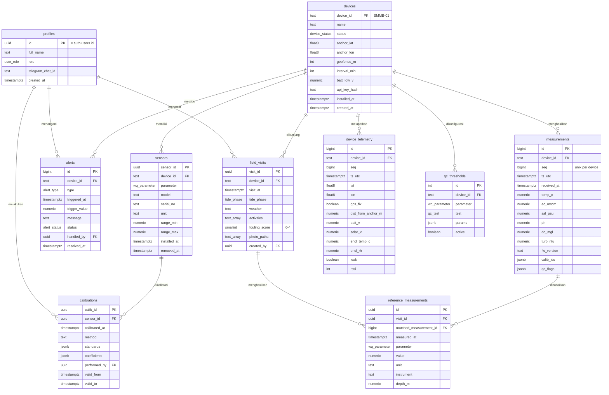

# SMMB — ERD & Database Schema

**Smart Marine Monitoring Buoy · Supabase (PostgreSQL 15+) · v1.1**

Skema ini mengikuti PRD SMMB v1.1: ESP32 mengirim data ke Supabase lewat Edge Function, dashboard Streamlit membaca data, dan alarm diproses di database lalu dikirim ke Telegram.

---

## 1. Ringkasan Tabel

| # | Tabel | Fungsi | Perkiraan volume |
|---|---|---|---|
| 1 | `profiles` | Pengguna dan role (terhubung ke `auth.users`) | < 20 baris |
| 2 | `devices` | Buoy, titik tambat, geofence, konfigurasi | 1 baris (MVP) |
| 3 | `sensors` | Sensor fisik yang terpasang di buoy | ± 5–10 baris |
| 4 | `calibrations` | Riwayat kalibrasi per sensor | ± 50 baris/tahun |
| 5 | `measurements` | Data kualitas air per siklus | ± 35.000 baris/tahun |
| 6 | `device_telemetry` | Kesehatan perangkat per siklus (GPS, baterai, kebocoran) | ± 35.000 baris/tahun |
| 7 | `field_visits` | Kunjungan lapangan (pembersihan, foto fouling) | ± 50 baris/tahun |
| 8 | `reference_measurements` | Pengukuran referensi MPV / alat lab | ± 250 baris/tahun |
| 9 | `qc_thresholds` | Ambang uji QC per parameter | ± 30 baris |
| 10 | `alerts` | Riwayat alarm dan penanganannya | bervariasi |

Perhitungan volume: interval 15 menit = 96 record/hari × 365 hari ≈ 35.000 baris/tahun per buoy.

---

## 2. ERD



**Catatan desain**

- `measurements` dan `device_telemetry` dipisah: data ilmiah dan data kesehatan perangkat punya QC, akses, dan masa simpan yang berbeda. Keduanya dihubungkan oleh pasangan `(device_id, seq)`.
- `seq` (nomor urut dari ESP32) + constraint `UNIQUE (device_id, seq)` mencegah duplikasi saat backfill dan memudahkan menghitung data yang hilang.
- `calib_ids` di `measurements` mencatat kalibrasi yang berlaku saat data diambil, sehingga setiap nilai bisa ditelusuri ke kalibrasinya (NFR-09).
- `reference_measurements.matched_measurement_id` diisi otomatis dengan record buoy terdekat dalam selisih ±5 menit (protokol validasi PRD 3.4).

---

## 3. Skema SQL

Jalankan berurutan di Supabase SQL Editor, atau simpan sebagai `db/schema.sql` di repositori.

### 3.1 Enum

```sql
create type user_role     as enum ('admin', 'researcher', 'supervisor', 'technician');
create type device_status as enum ('planned', 'testing', 'deployed', 'maintenance', 'retired', 'lost');
create type wq_parameter  as enum ('temp', 'ec', 'salinity', 'turbidity', 'ph', 'do');
create type qc_test       as enum ('gross_range', 'spike', 'flat_line', 'rate_of_change');
create type tide_phase    as enum ('high', 'ebb', 'low', 'flood', 'unknown');
create type alert_type    as enum ('geofence', 'battery_low', 'no_data', 'out_of_range', 'leak');
create type alert_status  as enum ('open', 'acknowledged', 'resolved');
```

### 3.2 Tabel

```sql
-- 1. Pengguna
create table profiles (
  id               uuid primary key references auth.users(id) on delete cascade,
  full_name        text not null,
  role             user_role not null default 'researcher',
  telegram_chat_id text,
  created_at       timestamptz not null default now()
);

-- 2. Buoy
create table devices (
  device_id     text primary key,                      -- contoh: 'SMMB-01'
  name          text not null,
  status        device_status not null default 'planned',
  anchor_lat    double precision,                      -- koordinat presisi: hanya role berwenang
  anchor_lon    double precision,
  geofence_m    integer not null default 50 check (geofence_m > 0),
  interval_min  integer not null default 15 check (interval_min between 1 and 240),
  batt_low_v    numeric(4,2) not null default 11.80,
  api_key_hash  text not null,                         -- hash API key perangkat, bukan key asli
  installed_at  timestamptz,
  created_at    timestamptz not null default now()
);

-- 3. Sensor
create table sensors (
  sensor_id    uuid primary key default gen_random_uuid(),
  device_id    text not null references devices(device_id) on delete cascade,
  parameter    wq_parameter not null,
  model        text not null,
  serial_no    text,
  unit         text not null,
  range_min    numeric,
  range_max    numeric,
  installed_at timestamptz not null default now(),
  removed_at   timestamptz,
  check (removed_at is null or removed_at > installed_at)
);
-- satu sensor aktif per parameter per buoy
create unique index sensors_one_active
  on sensors (device_id, parameter) where removed_at is null;

-- 4. Kalibrasi
create table calibrations (
  calib_id      uuid primary key default gen_random_uuid(),
  sensor_id     uuid not null references sensors(sensor_id) on delete cascade,
  calibrated_at timestamptz not null,
  method        text not null,                         -- contoh: '3-point buffer 4/7/10'
  standards     jsonb not null,                        -- nilai larutan standar + bacaan sensor
  coefficients  jsonb not null,                        -- contoh: {"slope":1.02,"offset":-0.05}
  performed_by  uuid references profiles(id),
  valid_from    timestamptz not null,
  valid_to      timestamptz,
  notes         text
);
create index on calibrations (sensor_id, valid_from desc);

-- 5. Data kualitas air
create table measurements (
  id          bigint generated always as identity primary key,
  device_id   text not null references devices(device_id),
  seq         bigint not null,
  ts_utc      timestamptz not null,
  received_at timestamptz not null default now(),
  temp_c      numeric(5,2),
  ec_mscm     numeric(6,2),
  sal_psu     numeric(5,2),
  ph          numeric(4,2),
  do_mgl      numeric(5,2),
  turb_ntu    numeric(7,2),
  fw_version  text,
  calib_ids   jsonb,                                   -- {"ph":"<uuid>","ec":"<uuid>",...}
  qc_flags    jsonb not null default '{}'::jsonb,      -- {"temp_c":1,"turb_ntu":3,...}
  unique (device_id, seq)
);
create index on measurements (device_id, ts_utc desc);

-- 6. Kesehatan perangkat
create table device_telemetry (
  id                 bigint generated always as identity primary key,
  device_id          text not null references devices(device_id),
  seq                bigint not null,
  ts_utc             timestamptz not null,
  lat                double precision,
  lon                double precision,
  gps_fix            boolean not null default false,
  dist_from_anchor_m numeric(8,1),                     -- diisi trigger
  batt_v             numeric(4,2),
  solar_v            numeric(4,2),
  encl_temp_c        numeric(4,1),
  encl_rh            numeric(4,1),
  leak               boolean not null default false,
  rssi               integer,
  unique (device_id, seq)
);
create index on device_telemetry (device_id, ts_utc desc);

-- 7. Kunjungan lapangan
create table field_visits (
  visit_id      uuid primary key default gen_random_uuid(),
  device_id     text not null references devices(device_id),
  visit_at      timestamptz not null,
  tide_phase    tide_phase not null default 'unknown',
  weather       text,
  activities    text[] not null default '{}',          -- {'cleaning','calibration','inspection'}
  fouling_score smallint check (fouling_score between 0 and 4),
  photo_paths   text[] not null default '{}',          -- path di Supabase Storage
  notes         text,
  created_by    uuid references profiles(id),
  created_at    timestamptz not null default now()
);

-- 8. Pengukuran referensi
create table reference_measurements (
  id                     uuid primary key default gen_random_uuid(),
  visit_id               uuid not null references field_visits(visit_id) on delete cascade,
  matched_measurement_id bigint references measurements(id),
  measured_at            timestamptz not null,
  parameter              wq_parameter not null,
  value                  numeric not null,
  unit                   text not null,
  instrument             text not null,                -- contoh: 'Lutron WAC-2019SD #123'
  depth_m                numeric(4,2)
);
create index on reference_measurements (parameter, measured_at);

-- 9. Ambang QC
create table qc_thresholds (
  id        integer generated always as identity primary key,
  device_id text not null references devices(device_id) on delete cascade,
  parameter wq_parameter not null,
  test      qc_test not null,
  params    jsonb not null,                            -- contoh gross_range: {"min":0,"max":40}
  active    boolean not null default true,
  unique (device_id, parameter, test)
);

-- 10. Alarm
create table alerts (
  id            bigint generated always as identity primary key,
  device_id     text not null references devices(device_id),
  type          alert_type not null,
  triggered_at  timestamptz not null default now(),
  trigger_value numeric,
  message       text not null,
  status        alert_status not null default 'open',
  handled_by    uuid references profiles(id),
  resolved_at   timestamptz
);
-- cegah alarm ganda: hanya satu alarm terbuka per jenis per buoy
create unique index alerts_one_open
  on alerts (device_id, type) where status <> 'resolved';
```

### 3.3 Fungsi & Trigger

```sql
-- Jarak dari titik tambat (rumus haversine, meter)
create or replace function haversine_m(lat1 float8, lon1 float8, lat2 float8, lon2 float8)
returns float8 language sql immutable as $$
  select 2 * 6371000 * asin(sqrt(
    power(sin(radians(lat2 - lat1) / 2), 2) +
    cos(radians(lat1)) * cos(radians(lat2)) * power(sin(radians(lon2 - lon1) / 2), 2)
  ));
$$;

-- Isi jarak + buat alarm geofence / baterai / kebocoran
create or replace function telemetry_before_insert()
returns trigger language plpgsql security definer as $$
declare d devices;
begin
  select * into d from devices where device_id = new.device_id;

  if new.gps_fix and d.anchor_lat is not null then
    new.dist_from_anchor_m := haversine_m(d.anchor_lat, d.anchor_lon, new.lat, new.lon);
    if new.dist_from_anchor_m > d.geofence_m then
      insert into alerts (device_id, type, trigger_value, message)
      values (new.device_id, 'geofence', new.dist_from_anchor_m,
              format('Buoy %s berada %s m dari titik tambat', new.device_id, round(new.dist_from_anchor_m)))
      on conflict do nothing;
    end if;
  end if;

  if new.batt_v is not null and new.batt_v < d.batt_low_v then
    insert into alerts (device_id, type, trigger_value, message)
    values (new.device_id, 'battery_low', new.batt_v,
            format('Baterai %s V di bawah ambang %s V', new.batt_v, d.batt_low_v))
    on conflict do nothing;
  end if;

  if new.leak then
    insert into alerts (device_id, type, message)
    values (new.device_id, 'leak', 'Sensor kebocoran enclosure terpicu')
    on conflict do nothing;
  end if;

  return new;
end $$;

create trigger trg_telemetry before insert on device_telemetry
for each row execute function telemetry_before_insert();

-- QC gross range otomatis (uji lain dijalankan terjadwal di analysis/)
create or replace function measurements_qc_gross_range()
returns trigger language plpgsql as $$
declare
  t record;
  v numeric;
  col text;
  flags jsonb := '{}'::jsonb;
begin
  for t in
    select parameter, params from qc_thresholds
    where device_id = new.device_id and test = 'gross_range' and active
  loop
    col := case t.parameter
             when 'temp' then 'temp_c'       when 'ec' then 'ec_mscm'
             when 'salinity' then 'sal_psu'  when 'turbidity' then 'turb_ntu'
             when 'ph' then 'ph'             when 'do' then 'do_mgl' end;
    v := (to_jsonb(new) ->> col)::numeric;
    flags := flags || jsonb_build_object(col,
      case when v is null then 9
           when v < (t.params->>'min')::numeric or v > (t.params->>'max')::numeric then 4
           else 1 end);
  end loop;
  new.qc_flags := new.qc_flags || flags;
  return new;
end $$;

create trigger trg_measurements_qc before insert on measurements
for each row execute function measurements_qc_gross_range();
```

Alarm `no_data` (tidak ada data > 60 menit) tidak bisa dipicu oleh insert, karena justru tidak ada insert. Jalankan pemeriksaan terjadwal dengan `pg_cron` di Supabase:

```sql
select cron.schedule('check-no-data', '*/15 * * * *', $$
  insert into alerts (device_id, type, message)
  select d.device_id, 'no_data', 'Tidak ada data lebih dari 60 menit'
  from devices d
  where d.status = 'deployed'
    and not exists (
      select 1 from measurements m
      where m.device_id = d.device_id and m.received_at > now() - interval '60 minutes')
  on conflict do nothing;
$$);
```

Pengiriman ke Telegram: Database Webhook pada `insert` di tabel `alerts` → Edge Function `notify-telegram` → kirim ke `profiles.telegram_chat_id` dengan role `admin`, `researcher`, dan `technician`.

### 3.4 View

```sql
-- Data publik: koordinat dibulatkan (± 1 km), hanya data lolos QC
create or replace view v_public_measurements as
select m.device_id, m.ts_utc, m.temp_c, m.sal_psu, m.ph, m.do_mgl, m.turb_ntu,
       round(t.lat::numeric, 2) as lat_approx,
       round(t.lon::numeric, 2) as lon_approx
from measurements m
left join device_telemetry t using (device_id, seq)
where not exists (
  select 1 from jsonb_each_text(m.qc_flags) f where f.value::int in (3, 4)
);

-- Data availability harian (KPI ≥ 90%)
create or replace view v_daily_availability as
select m.device_id,
       date_trunc('day', m.ts_utc) as day,
       count(*) as received,
       (1440 / d.interval_min) as expected,
       round(100.0 * count(*) / (1440 / d.interval_min), 1) as availability_pct
from measurements m
join devices d using (device_id)
group by m.device_id, date_trunc('day', m.ts_utc), d.interval_min;

-- Pasangan sensor vs referensi untuk analisis bias/RMSE
create or replace view v_validation_pairs as
select r.parameter, r.measured_at, r.value as ref_value, r.instrument,
       case r.parameter
         when 'temp' then m.temp_c      when 'ec' then m.ec_mscm
         when 'salinity' then m.sal_psu when 'turbidity' then m.turb_ntu
         when 'ph' then m.ph            when 'do' then m.do_mgl end as sensor_value,
       m.ts_utc as sensor_ts, v.fouling_score
from reference_measurements r
join field_visits v using (visit_id)
join measurements m on m.id = r.matched_measurement_id;
```

---

## 4. Row Level Security

```sql
alter table profiles               enable row level security;
alter table devices                enable row level security;
alter table sensors                enable row level security;
alter table calibrations           enable row level security;
alter table measurements           enable row level security;
alter table device_telemetry       enable row level security;
alter table field_visits           enable row level security;
alter table reference_measurements enable row level security;
alter table qc_thresholds          enable row level security;
alter table alerts                 enable row level security;

create or replace function my_role() returns user_role
language sql stable security definer as $$
  select role from profiles where id = auth.uid();
$$;

-- Baca: semua pengguna login
create policy read_all on measurements     for select to authenticated using (true);
create policy read_all on device_telemetry for select to authenticated using (true);
create policy read_all on devices          for select to authenticated using (true);
create policy read_all on alerts           for select to authenticated using (true);
create policy read_all on field_visits     for select to authenticated using (true);
create policy read_all on reference_measurements for select to authenticated using (true);
create policy read_all on calibrations     for select to authenticated using (true);
create policy read_all on sensors          for select to authenticated using (true);

-- Tulis data lapangan: admin, researcher, technician
create policy write_field on field_visits for insert to authenticated
  with check (my_role() in ('admin', 'researcher', 'technician'));
create policy write_ref on reference_measurements for insert to authenticated
  with check (my_role() in ('admin', 'researcher', 'technician'));
create policy write_calib on calibrations for insert to authenticated
  with check (my_role() in ('admin', 'researcher', 'technician'));

-- Tangani alarm: admin, researcher, technician
create policy handle_alert on alerts for update to authenticated
  using (my_role() in ('admin', 'researcher', 'technician'));

-- Konfigurasi: admin saja
create policy admin_devices on devices       for all to authenticated using (my_role() = 'admin');
create policy admin_qc      on qc_thresholds for all to authenticated using (my_role() = 'admin');
create policy admin_sensors on sensors       for all to authenticated using (my_role() = 'admin');

-- Profil: lihat milik sendiri; admin lihat semua
create policy own_profile on profiles for select to authenticated
  using (id = auth.uid() or my_role() = 'admin');
```

Data dari ESP32 **tidak** masuk lewat RLS. Edge Function `ingest` memverifikasi API key perangkat terhadap `devices.api_key_hash`, lalu menulis memakai service role key yang hanya tersimpan di Supabase, tidak pernah di ESP32 atau di GitHub.

---

## 5. Kode Flag QC

| Kode | Arti | Dipakai di dashboard |
|---|---|---|
| 1 | Lolos | Ditampilkan normal |
| 2 | Belum dievaluasi | Ditampilkan normal |
| 3 | Mencurigakan | Ditampilkan dengan penanda |
| 4 | Gagal | Disembunyikan dari grafik utama dan data publik |
| 9 | Hilang | Celah pada grafik |

Contoh nilai `qc_flags`: `{"temp_c":1,"sal_psu":1,"turb_ntu":3,"ph":9}`

### Ambang gross range awal (disesuaikan setelah uji lapangan)

| Parameter | Min | Max | Unit |
|---|---|---|---|
| temp | 20 | 40 | °C |
| ec | 0 | 70 | mS/cm |
| salinity | 0 | 40 | PSU |
| turbidity | 0 | 1000 | NTU |
| ph | 6.0 | 9.5 | pH |
| do | 0 | 15 | mg/L |

```sql
insert into qc_thresholds (device_id, parameter, test, params) values
  ('SMMB-01', 'temp',      'gross_range', '{"min":20,"max":40}'),
  ('SMMB-01', 'ec',        'gross_range', '{"min":0,"max":70}'),
  ('SMMB-01', 'salinity',  'gross_range', '{"min":0,"max":40}'),
  ('SMMB-01', 'turbidity', 'gross_range', '{"min":0,"max":1000}'),
  ('SMMB-01', 'ph',        'gross_range', '{"min":6.0,"max":9.5}'),
  ('SMMB-01', 'do',        'gross_range', '{"min":0,"max":15}');
```

---

## 6. Kontrak Payload ESP32 → Edge Function `ingest`

**Request**

```http
POST https://<project>.supabase.co/functions/v1/ingest
x-device-key: <API key perangkat>
Content-Type: application/json
```

**Body** — array, supaya backlog dari microSD bisa dikirim sekaligus:

```json
[
  {
    "device_id": "SMMB-01",
    "seq": 10452,
    "ts": "2027-03-01T02:15:00Z",
    "temp_c": 30.4,
    "ec_mscm": 44.1,
    "sal_psu": 28.6,
    "turb_ntu": 35.2,
    "ph": null,
    "do_mgl": null,
    "lat": -7.30000,
    "lon": 112.80000,
    "gps_fix": true,
    "batt_v": 12.9,
    "solar_v": 17.8,
    "encl_temp_c": 36.1,
    "encl_rh": 58.0,
    "leak": false,
    "rssi": -79,
    "fw": "1.0.3"
  }
]
```

**Response**

```json
{ "accepted": [10452], "duplicate": [], "rejected": [] }
```

ESP32 menandai record di microSD sebagai terkirim jika `seq`-nya muncul di `accepted` atau `duplicate`. Insert memakai `on conflict (device_id, seq) do nothing`, jadi pengiriman ulang aman.

---

## 7. Kamus Data Singkat

| Kolom | Tabel | Tipe | Keterangan |
|---|---|---|---|
| `seq` | measurements, device_telemetry | bigint | Nomor urut dari ESP32, naik terus, disimpan di flash/microSD |
| `ts_utc` | measurements, device_telemetry | timestamptz | Waktu pengukuran dari RTC, UTC |
| `received_at` | measurements | timestamptz | Waktu diterima server; selisih dengan `ts_utc` = latensi |
| `sal_psu` | measurements | numeric | Salinitas praktis (PSS-78) dari EC + suhu |
| `calib_ids` | measurements | jsonb | ID kalibrasi yang berlaku per parameter |
| `qc_flags` | measurements | jsonb | Flag QC per kolom (Bagian 5) |
| `dist_from_anchor_m` | device_telemetry | numeric | Jarak dari titik tambat, dihitung trigger |
| `fouling_score` | field_visits | smallint | 0 = bersih, 4 = tertutup penuh; dinilai dari foto standar |
| `matched_measurement_id` | reference_measurements | bigint | Record buoy terdekat (selisih ±5 menit) |

---

## 8. Struktur File di Repositori

```
smmb/
└── db/
    ├── 01_enums.sql
    ├── 02_tables.sql
    ├── 03_functions_triggers.sql
    ├── 04_views.sql
    ├── 05_rls.sql
    ├── 06_seed_qc_thresholds.sql
    └── functions/
        ├── ingest/index.ts
        └── notify-telegram/index.ts
```

Jangan commit API key, service role key, atau koordinat titik tambat yang presisi jika repositori publik.
