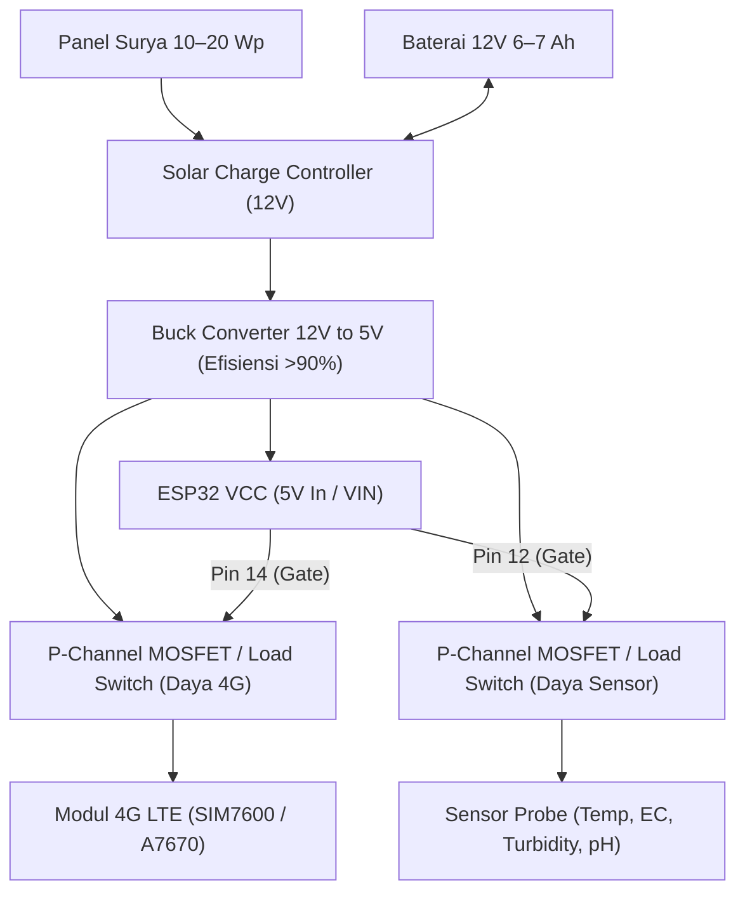

# SMMB — Wiring Diagram & Hardware Interfacing
**Smart Marine Monitoring Buoy · Institut Teknologi Sepuluh Nopember (ITS)**

Dokumen ini menjelaskan konfigurasi perkabelan (*wiring*), distribusi daya hemat energi, serta koneksi pin antara mikrokontroler ESP32, modul komunikasi 4G, GPS, penyimpanan lokal microSD, dan sensor kualitas air.

---

## 1. Arsitektur Manajemen Daya (Power Budgeting)

Buoy menggunakan sistem daya **12V LiFePO4 / Sealed Lead Acid** dengan panel surya dan Solar Charge Controller (SCC). Untuk memenuhi target otonomi energi ≥ 72 jam tanpa matahari, sensor dan modem seluler tidak boleh menyala terus-menerus.



---

## 2. Tabel Pemetaan Pin ESP32 (Pinout Mapping)

| Komponen | Pin ESP32 | Mode / Tipe Pin | Keterangan & Catatan |
|---|---|---|---|
| **Sensor Suhu (DS18B20)** | `GPIO 4` | Digital I/O (OneWire) | Pasang resistor *pull-up* 4.7 kΩ ke 3.3V/5V |
| **Probe EC / Salinitas** | `GPIO 34` | Analog In (`ADC1_CH6`) | Khusus ADC1 (tidak bentrok saat WiFi/modem aktif) |
| **Sensor Turbidity (Optik)** | `GPIO 35` | Analog In (`ADC1_CH7`) | Memerlukan housing gelap kedap air |
| **Probe pH Submersible** | `GPIO 32` | Analog In (`ADC1_CH4`) | Dari modul op-amp penguat pH |
| **Sensor Kebocoran (Leak)** | `GPIO 27` | Digital In (Pull-up) | Menempel di dasar enclosure. LOW jika basah |
| **Sensor Voltase Baterai** | `GPIO 33` | Analog In (`ADC1_CH5`) | Voltage Divider (R1=30kΩ, R2=10kΩ, rasio 4:1) |
| **MicroSD SPI CS** | `GPIO 5` | Output (SPI SS) | SPI Chip Select |
| **MicroSD SPI MOSI** | `GPIO 23` | Output (SPI MOSI) | Standar VSPI |
| **MicroSD SPI MISO** | `GPIO 19` | Input (SPI MISO) | Standar VSPI |
| **MicroSD SPI SCK** | `GPIO 18` | Output (SPI SCK) | Standar VSPI |
| **RTC DS3231 (SDA)** | `GPIO 21` | I2C SDA | Waktu UTC presisi saat offline |
| **RTC DS3231 (SCL)** | `GPIO 22` | I2C SCL | Standar I2C clock |
| **Modem 4G (TX)** | `GPIO 16` | UART RX2 | Menerima data dari Modem |
| **Modem 4G (RX)** | `GPIO 17` | UART TX2 | Mengirim AT Command ke Modem |
| **Switch Daya Modem (MOSFET)**| `GPIO 14` | Digital Out | HIGH = Modem Hidup, LOW = Modem Mati |
| **Switch Daya Sensor (MOSFET)**| `GPIO 12` | Digital Out | HIGH = Sensor Hidup, LOW = Sensor Mati |

---

## 3. Rangkaian Pembagi Tegangan Baterai (Battery Divider)

ESP32 hanya dapat menerima tegangan analog maksimal **3.3V**. Untuk membaca tegangan baterai 12V (rentang 10.5V – 14.6V saat pengisian solar), gunakan rangkaian pembagi tegangan:

```text
Baterai 12V (+) ───[ Resistor R1: 30 kΩ, 1% ]───┬───[ GPIO 33 ESP32 ]
                                                  │
                                        [ Resistor R2: 10 kΩ, 1% ]
                                                  │
                                                 GND
```

* Rumus Konversi Voltase:
  $$V_{batt} = V_{ADC} \times \frac{R_1 + R_2}{R_2} = V_{ADC} \times 4.0$$
* Kapasitor keramik **100 nF** dipasang paralel dengan R2 ke GND untuk menyaring *noise* tegangan akibat riak panel surya.

---

## 4. Perlindungan Enclosure & Cable Gland
* Semua kabel probe sensor yang keluar dari box enclosure wajib melalui **Cable Gland PG7 / PG9 bersertifikasi IP68**.
* Berikan gel silika (*silica gel desiccant*) di dalam box enclosure untuk menyerap kelembapan kondensasi udara laut tropis.
* Sensor kebocoran (dua strip konduktif tembaga berjarak 2 mm) ditempatkan tepat di titik terendah box enclosure.
